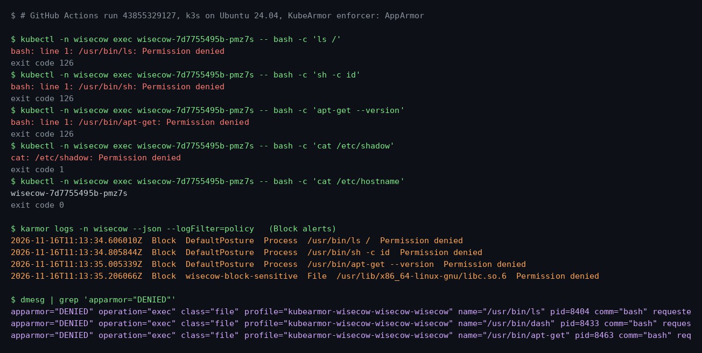

# Wisecow on Kubernetes

Wisecow is a small bash web server that answers every request with a random
fortune said by an ASCII cow. This repository is my solution to the AccuKnox
DevOps assignment. It containerises the app, deploys it on Kubernetes behind
an HTTPS ingress, builds and ships it with GitHub Actions, adds two Python
monitoring scripts, and locks the pods down with KubeArmor.

Original app: https://github.com/nyrahul/wisecow

## Requirement checklist

| # | Requirement | Where | Proof |
| --- | --- | --- | --- |
| 1.1 | Dockerfile for the app | [`Dockerfile`](Dockerfile) | Built and smoke tested in every CI run |
| 1.2 | Kubernetes manifests, app exposed as a Service | [`k8s/base/`](k8s/base) | Deployed on kind in the `e2e` CI job |
| 1.3 | GitHub Action that builds a new image on every change | [`.github/workflows/ci-cd.yaml`](.github/workflows/ci-cd.yaml) | `build` job pushes to GHCR on every push to `main` |
| 1.4 | Continuous deployment to Kubernetes | `deploy` and `e2e` jobs in the same workflow | `e2e` deploys the new image on every run; `deploy` targets a real cluster when `KUBECONFIG` is set |
| 1.5 | Challenge: TLS for the app | [`k8s/base/ingress.yaml`](k8s/base/ingress.yaml), [`k8s/overlays/`](k8s/overlays) | `e2e` job gets a cow over HTTPS and checks HTTP redirects to HTTPS |
| 2 | Two of the four scripts | [`scripts/system_health.py`](scripts/system_health.py), [`scripts/app_health.py`](scripts/app_health.py) | 11 pytest tests in CI |
| 3 | Bonus: KubeArmor zero trust policy and proof of violations | [`kubearmor/`](kubearmor) | [`kubearmor-proof.yaml`](.github/workflows/kubearmor-proof.yaml) workflow and [`kubearmor/proof/`](kubearmor/proof) |
| - | Private repo, read access for `nyrahul` | GitHub settings | Private; collaborator invite is added at submission time |

## Architecture

```
git push to main
   |
   v
GitHub Actions: lint and test -> build image -> push ghcr.io/satvik-svg/wisecow:sha-<commit>
                                     |
                                     +-> e2e: kind cluster, ingress-nginx, cert-manager, HTTPS check
                                     +-> deploy: kubectl apply -k k8s/overlays/prod (if KUBECONFIG is set)

Cluster:
client --HTTPS--> ingress-nginx (TLS cert from cert-manager) --> Service wisecow:80 --> Pods :4499 (2 replicas)
                                                                                          ^
                                                                    KubeArmor policies ---+
```

## Repository layout

```
Dockerfile                      image on debian:bookworm-slim, runs as uid 10001
wisecow.sh                      the original app, unchanged
k8s/base/                       Namespace, Deployment, Service, Ingress with TLS
k8s/overlays/prod/              Let's Encrypt ClusterIssuer, used by the deploy job
k8s/overlays/local/             self signed issuer and host wisecow.local, for kind and CI
.github/workflows/ci-cd.yaml    lint, test, build, push, end to end test, deploy
.github/workflows/kubearmor-proof.yaml   KubeArmor enforcement test on a real VM
hack/kind-config.yaml           kind cluster config
hack/kubearmor-proof.sh         runs the KubeArmor before and after checks
scripts/                        system_health.py, app_health.py and their tests
kubearmor/                      KubeArmor policies, notes and saved proof
```

## Quick start

Run the container:

```bash
docker build -t wisecow:local .
docker run --rm -p 4499:4499 wisecow:local
curl http://localhost:4499/
```

Run it on a local kind cluster with HTTPS:

```bash
kind create cluster --config hack/kind-config.yaml
kubectl apply -f https://raw.githubusercontent.com/kubernetes/ingress-nginx/controller-v1.14.5/deploy/static/provider/kind/deploy.yaml
kubectl apply -f https://github.com/cert-manager/cert-manager/releases/download/v1.21.3/cert-manager.yaml
kubectl -n cert-manager wait --for=condition=available deploy --all --timeout=180s

kind load docker-image wisecow:local --name wisecow
kubectl apply -k k8s/overlays/local
kubectl -n wisecow wait --for=condition=Ready certificate/wisecow-tls --timeout=120s

kubectl -n ingress-nginx port-forward svc/ingress-nginx-controller 8443:443 &
curl -k --resolve wisecow.local:8443:127.0.0.1 https://wisecow.local:8443/
```

The script serves one connection at a time and restarts `nc` after each
reply, so many requests in a row can see a short "connection refused". That
comes from the original script.

## Kubernetes deployment

- Deployment with 2 replicas, rolling updates with `maxUnavailable: 0`, TCP
  readiness and liveness probes, CPU and memory requests and limits.
- Runs as a non root user with a read only root filesystem, no privilege
  escalation and all capabilities dropped. `/app` (for the named pipe the
  script creates) and `/tmp` are small `emptyDir` volumes.
- No service account token is mounted, since the app never calls the API.
- ClusterIP Service on port 80 pointing at container port 4499, published
  through an nginx Ingress.

## CI/CD

[`.github/workflows/ci-cd.yaml`](.github/workflows/ci-cd.yaml) runs on every
push and pull request to `main`. It needs no secrets for the normal path.

1. **test**: actionlint, shellcheck, yamllint, ruff, kubeconform on both
   kustomize overlays, and the pytest suite.
2. **build**: builds the image and pushes it to GitHub Container Registry as
   `ghcr.io/satvik-svg/wisecow:sha-<commit>` and `:latest`, using the built
   in `GITHUB_TOKEN` (`packages: write`). Pull requests only build. A smoke
   test runs the image and expects a cow back.
3. **e2e**: creates a kind cluster on the runner, installs ingress-nginx and
   cert-manager, loads the image from step 2, deploys `k8s/overlays/local`,
   waits for the certificate, then checks that HTTPS returns a cow and that
   plain HTTP gets a 308 redirect. The cow shows up in the job summary.
4. **deploy**: on pushes to `main`, sets the new image with
   `kustomize edit set image` and runs `kubectl apply -k k8s/overlays/prod`
   against a real cluster. It skips cleanly when the `KUBECONFIG` secret
   (a base64 kubeconfig) is not set.

For the deploy job on a real cluster: the API server must be reachable from
GitHub runners, and since the repo is private the GHCR package is private
too, so either make the package public or add an image pull secret for
`ghcr.io` to the `wisecow` namespace.

## TLS

The Ingress asks cert-manager for a certificate stored in the `wisecow-tls`
secret, and nginx redirects HTTP to HTTPS.

- **Local and CI** (`k8s/overlays/local`): a self signed `ClusterIssuer`, host
  `wisecow.local`. Traffic is encrypted, but clients need `-k` or will show a
  browser warning, because no public authority signed the certificate.
- **Real domain** (`k8s/overlays/prod`): a Let's Encrypt `ClusterIssuer` with
  an HTTP-01 challenge. Point a DNS name at the ingress controller, replace
  `wisecow.example.com` in `k8s/base/ingress.yaml`, and apply the overlay.
  cert-manager then gets and renews a trusted certificate. This needs a domain
  and a public cluster, so it is not exercised in CI.

## Monitoring scripts

Two of the four optional scripts, both with tests in `scripts/tests/`.

```bash
cd scripts
python3 -m venv .venv && . .venv/bin/activate
pip install -r requirements-dev.txt
pytest -q tests
```

**`system_health.py`** checks CPU, memory and disk usage and the number of
running processes. Anything over its limit is logged as `ALERT` to the
console and a log file. Exit code 1 means there was an alert.

```bash
python system_health.py                                    # one check, limits 80% and 500 processes
python system_health.py --cpu 70 --memory 75 --disk 90 --processes 400
python system_health.py --interval 30 --log-file /var/log/system_health.log
```

**`app_health.py`** calls one or more URLs and reports `UP` or `DOWN` from the
HTTP status code (below 400 is up, or set `--ok-codes`). Timeouts and refused
connections count as `DOWN`.

```bash
python app_health.py https://wisecow.example.com/
python app_health.py --insecure https://wisecow.local:8443/ http://localhost:4499/
python app_health.py --ok-codes 200,204 --interval 60 https://example.com/health
```

## KubeArmor zero trust policy

Two policies in [`kubearmor/`](kubearmor), explained in
[`kubearmor/README.md`](kubearmor/README.md):

- `wisecow-process-allowlist.yaml` allows only the programs `wisecow.sh`
  needs (bash, nc, fortune, cowsay, perl and a few core tools). With the
  namespace file posture set to `block`, every other program is denied.
- `wisecow-block-sensitive.yaml` blocks `/etc/shadow`, writes under `/etc`
  and `/usr`, the service account token directory and raw sockets.

### Proof

[`kubearmor-proof.yaml`](.github/workflows/kubearmor-proof.yaml) runs on a
GitHub hosted Ubuntu 24.04 VM with a single node k3s cluster. KubeArmor uses
the AppArmor enforcer there. The workflow runs the same commands in a wisecow
pod before and after the policies, saves the KubeArmor alerts, and fails if
nothing is blocked or if the app stops working.

Reference run: https://github.com/satvik-svg/accuknox-devops-wisecow/actions/runs/43855329127
(saved output in [`kubearmor/proof/`](kubearmor/proof)).



| Command run from bash in the pod | Before | After |
| --- | --- | --- |
| `ls /` | works | `Permission denied`, exit 126 |
| `sh -c id` | works | `Permission denied`, exit 126 |
| `apt-get --version` | works | `Permission denied`, exit 126 |
| `cat /etc/shadow` | denied | denied, plus a KubeArmor alert |
| `cat /etc/hostname` | works | works |
| `/usr/games/fortune -s` and the app itself | works | works |

KubeArmor alerts from `karmor logs -n wisecow --json`, trimmed:

```
{"PodName":"wisecow-7d7755495b-pmz7s","PolicyName":"DefaultPosture","Operation":"Process","Resource":"/usr/bin/ls /","Action":"Block","Result":"Permission denied"}
{"PodName":"wisecow-7d7755495b-pmz7s","PolicyName":"DefaultPosture","Operation":"Process","Resource":"/usr/bin/sh -c id","Action":"Block","Result":"Permission denied"}
{"PodName":"wisecow-7d7755495b-pmz7s","PolicyName":"DefaultPosture","Operation":"Process","Resource":"/usr/bin/apt-get --version","Action":"Block","Result":"Permission denied"}
{"PodName":"wisecow-7d7755495b-pmz7s","PolicyName":"wisecow-block-sensitive","Operation":"File","Source":"/usr/bin/cat /etc/shadow","Action":"Block","Result":"Permission denied"}
```

The kernel log confirms the denials came from the KubeArmor AppArmor profile:

```
apparmor="DENIED" operation="exec" class="file" profile="kubearmor-wisecow-wisecow-wisecow" name="/usr/bin/ls" comm="bash" denied_mask="x"
apparmor="DENIED" operation="exec" class="file" profile="kubearmor-wisecow-wisecow-wisecow" name="/usr/bin/dash" comm="bash" denied_mask="x"
apparmor="DENIED" operation="exec" class="file" profile="kubearmor-wisecow-wisecow-wisecow" name="/usr/bin/apt-get" comm="bash" denied_mask="x"
```

Notes:

- The pod runs as a non root user, so normal Linux permissions already stop
  `cat /etc/shadow`. The KubeArmor rule is a second layer in case the
  container ever runs as root.
- AppArmor checks programs started from inside the container. The first
  command `kubectl exec` starts is where the profile gets attached, so the
  test runs everything through bash, which is how an injected command
  would run.

## Author

Satvik Srivastava (satvik764@gmail.com)
